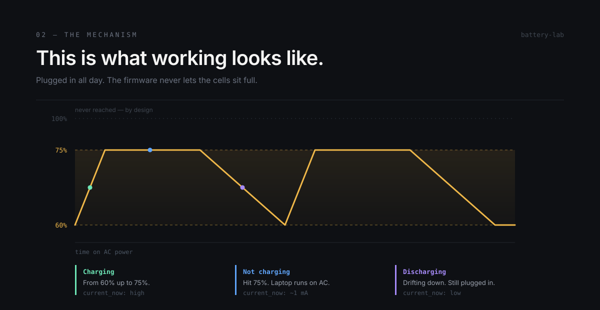

# battery-lab

A read-only, zero-dependency logbook and trend analyzer for laptop battery health on Linux.




## Purpose

battery-lab records what a laptop battery actually does, so you can check that a charge limit is
working and measure capacity loss over months instead of guessing.

## Why this project exists

Firmware on many business laptops supports charge limits, but the friendly vendor tooling usually
stays on Windows. On Linux you can set a limit and still have no evidence that it holds, or that it
slows wear. A single `cat` of a sysfs file gives one number. Answering those questions takes a
time series and an estimator that tolerates noisy firmware readings. The background is in
[Why charge limits matter](docs/why.md).

## What it does

| Does | Does not |
|---|---|
| Read battery, thermal and DMI data from `/sys` | Write to `/sys`, the kernel or the firmware |
| Take one sample per run, then exit | Run a daemon or background process |
| Append samples to a private CSV on your disk | Send data anywhere |
| Summarize health, time in each status and heat | Set, or even read, your charge threshold |
| Estimate the long-term health trend with confidence bounds | Need `sudo` or any runtime dependency |
| Generate clearly labelled synthetic logs for validation | Mix synthetic data into an existing log |

## Architecture

```
/sys ──► readers/ ──► models.BatterySample ──► storage/CsvStore ──► data/battery.csv
                                                                          │
                     cli/ (collect, json, show, trend, simulate) ◄── analysis/
                                                                  summary, trend, robust
```

Readers are the only code that touches `/sys`, analysis is pure functions, and the CLI is the only
layer that prints. Details are in [docs/ARCHITECTURE.md](docs/ARCHITECTURE.md).

## Quick start

Requires Linux and Python 3.11 or newer.

```sh
python3 -m venv ~/.venvs/battery-lab && . ~/.venvs/battery-lab/bin/activate
pip install git+https://github.com/juanmafx/battery-lab
battery-lab collect && battery-lab show
echo "*/5 * * * * $(command -v battery-lab) collect >/dev/null 2>>\$HOME/.battery-lab.err"
```

The last line prints a cron entry. Add it yourself with `crontab -e`.

## Usage guide

| Command | What it does |
|---|---|
| `battery-lab collect` | Takes one sample and appends it to the CSV |
| `battery-lab json` | Prints one sample as JSON and writes nothing |
| `battery-lab show` | Summarizes health, status time, gaps and temperature |
| `battery-lab trend` | Estimates the health slope, its confidence interval and a threshold projection |
| `battery-lab simulate --output new.csv` | Writes a seeded synthetic log to a new file |

Try the analysis without waiting months for real data:

```sh
battery-lab simulate --output /tmp/synthetic.csv --seed 2026 --days 365 --fade 4
battery-lab trend --data /tmp/synthetic.csv
```

`trend` needs at least 10 measured days. Its projection is a linear extrapolation, not a
measurement or a warranty of battery life. The method and its limits are in
[docs/methods.md](docs/methods.md).

## Configuration

| Setting | Default | Purpose |
|---|---|---|
| `--data PATH` | `data/battery.csv` in a checkout, otherwise `$XDG_DATA_HOME/battery-lab/data/battery.csv` | CSV logbook |
| `--env-file PATH` | `.env` beside the data home | File holding `MACHINE_ID` |
| `--sysfs-root PATH` | `/sys` | Alternate sysfs tree, used by the tests |
| `MACHINE_ID` | product name and SKU from DMI | Stable label for this machine |
| `trend --threshold PCT` | `70` | Health level to project |
| `trend --confidence LEVEL` | `0.95` | Confidence level of the interval and test |
| `trend --seed N` | `2026` | Seed for pair sampling on very long logs |

## Database schema (optional)

The CLI stores CSV and never needs a database. [db/schema.sql](db/schema.sql) is an optional,
normalized SQLite schema for anyone who wants to query logs with SQL. The test suite applies it and
checks its constraints.

```sh
sqlite3 battery.db < db/schema.sql
```

## Testing

```sh
python3 -m venv .venv && . .venv/bin/activate
pip install --require-hashes --only-binary=:all: -r requirements/dev.lock
pytest --hypothesis-seed=2026
ruff check battery_lab collect.py scripts tests
mypy
```

The suite combines synthetic sysfs fixtures, property-based tests and seeded statistical checks.
Reports from real runs are committed under [reports/tests/](reports/tests/), and the estimator
validation output is in [reports/validation/estimators.txt](reports/validation/estimators.txt).

## Security notes

- The tool runs unprivileged, opens no network connections and has no runtime dependencies.
- New logs are created with mode `0600` because they can contain battery serial numbers. Review a
  log before sharing it.
- CSV cells are protected against spreadsheet formula injection, and terminal output strips control
  characters that firmware strings or edited logs could carry.

See [SECURITY.md](SECURITY.md) and the [security audit](docs/SECURITY_AUDIT.md).

## Documentation

| Page | What's in it |
|---|---|
| [Why charge limits matter](docs/why.md) | The physics, the trade-offs and realistic expectations |
| [How it works](docs/how-it-works.md) | The pipeline, the 60/75 cycle and the read-only design |
| [Install and use](docs/install.md) | Installation, commands, cron and file locations |
| [Data format](docs/data-format.md) | Every CSV column, machine identity and header migration |
| [Statistical methods](docs/methods.md) | Estimators, complexity, reproducibility and limitations |
| [Known quirks](docs/quirks.md) | Firmware and sensor oddities |
| [Architecture](docs/ARCHITECTURE.md) | Module responsibilities and repository layout |
| [Changelog](CHANGELOG.md) · [Release notes](RELEASE_NOTES.md) | Version history |

## Project history

Originally created in 2026 and modernized in 2026.

## Author

**Juan Manuel Ramallo**, Senior Full Stack Engineer and Tech Lead.
[GitHub](https://github.com/juanmafx) · [LinkedIn](https://www.linkedin.com/in/juan-manuel-ramallo)

## License

MIT. See [LICENSE](LICENSE).
