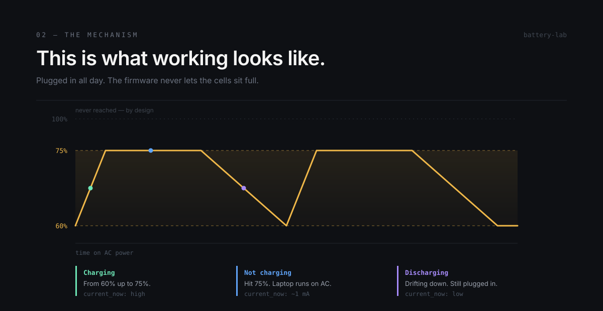
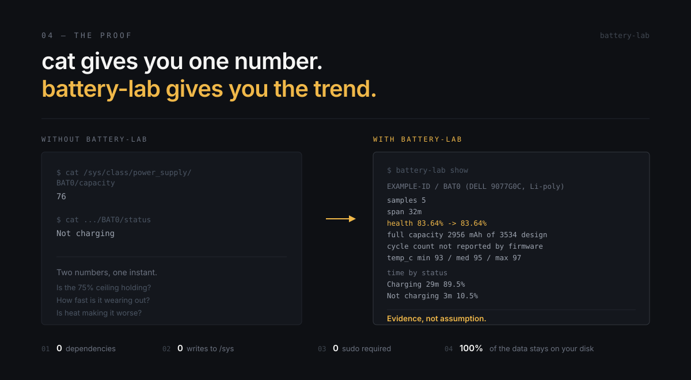

# How it works

This page covers what happens on each run, the 60/75 firmware cycle, and what the log answers.

```
cron, every 5 minutes
  │
  ▼
battery-lab collect ──► reads /sys, never writes
  │                       ├─ class/power_supply/BAT*/uevent    battery
  │                       ├─ class/thermal/thermal_zone*/temp  heat
  │                       └─ class/dmi/id/                     machine identity
  ▼
data/battery.csv ◄──── one row per battery, per run
  │
  ▼
battery-lab show ──► health delta · time by status · gaps · temperature
```

Each run takes one sample and exits. Nothing stays running between samples.

## The 60/75 cycle



This is what a working 60/75 limit looks like while the laptop stays plugged in.

| Stage | What the firmware does | `STATUS` | `CURRENT_NOW` |
|---|---|---|---|
| 1 | Charges the battery toward 75% | `Charging` | high |
| 2 | Stops at 75%, powers the laptop from AC | `Not charging` | near zero (1 mA on the Latitude 3410) |
| 3 | Lets the charge drift down | `Discharging` | low |
| back to 1 | Resumes charging at 60% | `Charging` | high |

On the test bench, stages 2 and 3 flip back and forth several times while plugged in before the
charge ever reaches 60%. You can only see that pattern with periodic sampling, which is why the
cron job matters more than any single reading.

If your log shows long stretches of `Charging` above your upper limit, or the battery sitting at
100%, the threshold isn't being applied.

## What this tool does



It doesn't set thresholds: that's vendor-specific and needs root. It **logs** what actually
happens, one sample per run, and answers three questions:

| Question | What the log shows you |
|---|---|
| Is my charge threshold actually working? | Charging stops near your upper limit and restarts near your lower one. Long stretches of `Charging` above the limit, or a battery sitting at 100%, mean it isn't applied. |
| How fast is the battery wearing out? | **`health_pct`** from the first sample to the last, over weeks and months. |
| Is heat undoing the benefit? | `temp_c` next to `status`, plus how much time the battery spends charging, holding and drifting. |

```
health_pct = CHARGE_FULL / CHARGE_FULL_DESIGN * 100
```

Batteries that report energy instead of charge use `ENERGY_FULL / ENERGY_FULL_DESIGN`.

**Test bench:** Dell Latitude 3410, battery DELL 9077G0C, firmware thresholds 60/75.
Baseline health: **83.6% on 2026-09-13**.

## Read-only, by design

battery-lab **only reads** from `/sys`. It never writes to the kernel and never needs `sudo`.

It deliberately doesn't read or write charge thresholds:

- On Dell they live in `/sys/class/firmware-attributes/`, where even *reading* them requires root.
  A logbook that runs from cron every few minutes shouldn't run as root.
- Writing them changes firmware behavior that persists across reboots and operating systems. A
  measurement tool that also changes what it measures isn't a reliable test bench.
- Thresholds are set once, on purpose, outside this tool (the BIOS setup or vendor tooling). Their
  effect is still visible in the log as [the 60/75 cycle](#the-6075-cycle).

Not in scope: threshold writing, daemon mode, external dependencies, GUI/TUI.

---

Next: [Install and use](install.md)

[Documentation index](README.md) · [Project README](../README.md)
