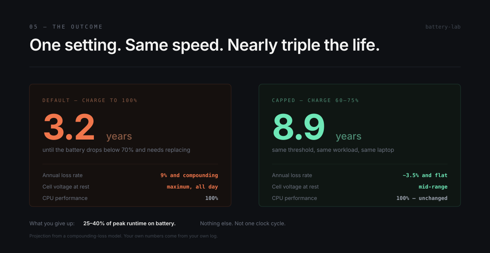
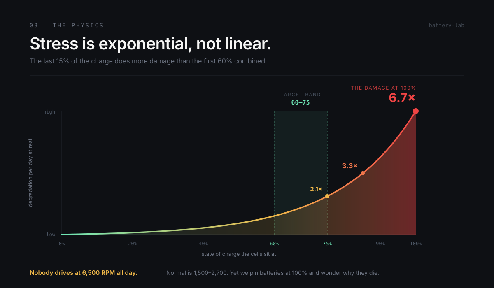

# Why charge limits matter

This page covers why capping the charge extends battery life, what it costs, and what to expect.

 8.9 years (projection)">

## The story

ThinkPads ship with Lenovo Vantage on Windows, which lets you cap how far the battery charges.
Switch to Ubuntu and you lose that app, even though the firmware still supports the limit. It's the
same story on most Dell, ASUS and HP business laptops: the capability is in the firmware, but the
friendly tooling stays behind on Windows.

## The physics, in one analogy

6.7x is the instantaneous stress at 100% state of charge versus 60%. Observed annual degradation
lands closer to 2x, because no battery sits at 100% every minute of every day. The multiplier is
the mechanism; the 2x is the outcome.

> Nobody drives a car at 6,500 RPM all day. Normal is 1,500–2,700. Yet we leave laptop batteries
> pinned at 100% charge for years and then wonder why they die.

Lithium cells degrade fastest at a high state of charge. The exact factor depends on the cell
chemistry and on temperature. A 60–75% window keeps the cells relaxed instead of under constant
high-voltage stress.

## This costs you zero performance

> Capping the charge is not a power-saving mode. Your machine runs exactly as fast as before.

It doesn't touch CPU frequency, thermal limits or anything else. You're managing cell voltage, not
throttling hardware.

What you give up is 25–40% of peak runtime on battery. With a 60–75 window the available charge
varies across that range: somewhere between 60% and 75% of a full battery, instead of 100%. If
you're a typical developer who works plugged in and only needs the battery now and then (a
meeting, a trip), you'll barely notice.

## Realistic expectations

- The lifespan figures in the charts are a **projection** from a compounding-loss model, not a
  measurement. They fit best a laptop that lives on a charger, where high-charge aging is the main
  thing wearing the battery down.
- The model projects 8.9 years to the 70% replacement threshold, versus 3.2 years without a cap.
  Assuming heat, calendar aging and unit variance eat half the benefit, the conservative floor is
  5-6 years. Either way it lasts substantially longer: 1.6x at the conservative floor, 2.8x at
  the projection.
- The only numbers that apply to your battery are the ones in your own log.
- **Existing damage does not reverse.** A limit slows future loss; it doesn't restore lost
  capacity.
- **Heat degrades cells about as much as voltage does.** A hot laptop, or a background process
  pinning a core for weeks, can eat a large part of the benefit.

> A battery log without temperature only tells half the story.

A charge limit can look perfect on paper while the cells sit in a hot chassis all day. That's why
battery-lab records a temperature with every battery reading. High heat while `Charging` is the
combination to watch. What that temperature does and doesn't measure is covered in
[Known quirks](quirks.md).

## Why it matters beyond your laptop

> A dead battery is often what sends an otherwise healthy laptop to landfill.

The CPU still works. The SSD still works. The battery is the consumable part, and it frequently
decides when the whole machine gets retired. Extending its life is one of the cheapest
sustainability wins available.

---

Next: [How it works](how-it-works.md)

[Documentation index](README.md) · [Project README](../README.md)
